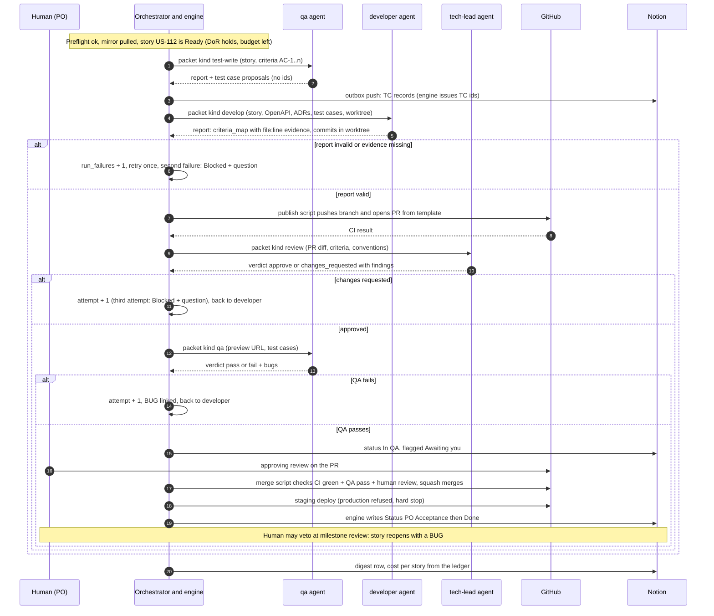

# 08 Target folder structure and workflow diagrams

Status: `[PROPOSED]`. The "after" structure is the target once the build is done and the documentation is cleaned up; the cleanup itself needs the owner's approval (see `START-HERE.md`, third prompt). Nothing here has been moved yet.

## 1. Folder structure: before and after

### Before (today)

```
arima/
├── START-HERE.md  README.md  CLAUDE.md  LICENSE  NOTICE
├── package.json  tsconfig.json  eslint.config.js  .prettierrc.json  .gitignore ...
├── vitest.config.ts  vitest.evals.config.ts  vitest.live.config.ts  vitest.agents.config.ts
├── .claude-plugin/marketplace.json
├── .github/workflows/ci.yml        .githooks/pre-push
├── scripts/                        build.mjs  check-dist.mjs  setup-hooks.mjs  tick-task.mjs
├── examples/                       arima.yaml  team.yaml  brief.md
├── evals/                          README.md  v0.1/
├── docs/
│   ├── spec/                       ARIMA-Master-Spec.md  README.md
│   ├── adr/                        ADR-0001 .. ADR-0006
│   ├── build/                      README, 00-08 docs, STATE.md, work-packages.yaml,
│   │                               agents/ (10 files), features/ (11 files)
│   ├── process/                    JUDGE.md  spec-issues.md  reviews/ (6 review files)
│   ├── BUILD-GUIDE.md  BUILD-PLAN.md  KICKOFF-PROMPT.md      (superseded)
│   ├── INSTALL.md  PRODUCT-GUIDE.md  NOTION-TEMPLATE.md  SETUP-CHECKLIST.md
└── plugins/arima/
    ├── .claude-plugin/plugin.json
    ├── agents/                     orchestrator.md                      (1 of 9)
    ├── skills/                     init  status  pause                  (3 of 18)
    ├── hooks/                      hooks.json  guard.sh
    ├── catalog/                    artifacts.yaml
    ├── profiles/  schemas/  templates/
    ├── scripts/src/ + dist/ + test/ + test-live/
    └── LICENSE  NOTICE  README.md  CHANGELOG.md
```

### After (v1.0, cleaned up)

```
arima/
├── README.md                       what it is, 5-minute install, link to docs/
├── START-HERE.md                   only for contributors and fresh sessions
├── CLAUDE.md  LICENSE  NOTICE  CONTRIBUTING.md
├── package.json  tsconfig.json  eslint.config.js  .prettierrc.json
├── vitest/                         one folder: unit.ts  evals.ts  live.ts  agents.ts
├── .claude-plugin/marketplace.json
├── .github/workflows/              ci.yml  release.yml  (arima-daily.yml only after Gate U)
├── tools/                          build.mjs  check-dist.mjs  setup-hooks.mjs   (was scripts/)
├── examples/                       sample-project/  (brief, arima.yaml, team.yaml, stories)
├── evals/
│   ├── stub/                       engine scenarios with stub agents (run in CI)
│   ├── agents/                     real-agent evals, one folder per role (run by hand)
│   └── fixtures/                   scrubbed real responses, golden outputs
├── docs/
│   ├── spec/                       ARIMA-Master-Spec.md  (the authority)
│   ├── adr/                        ADR-0001 ..  (decisions)
│   ├── build/                      the live plan: README, STATE, work-packages.yaml,
│   │   │                           architecture, stages, contracts, verification, risks
│   │   ├── agents/                 one card per agent
│   │   └── features/               one spec per command / engine feature
│   ├── guides/                     INSTALL  PRODUCT  NOTION-TEMPLATE  SETUP-CHECKLIST
│   ├── process/                    JUDGE.md  spec-issues.md
│   └── archive/                    BUILD-GUIDE  BUILD-PLAN  KICKOFF-PROMPT  reviews/  (read-only history)
└── plugins/arima/                  the installable product; self-contained
    ├── .claude-plugin/plugin.json
    ├── agents/                     orchestrator  ba  ux  architect  tech-lead
    │                               developer  qa  security  devops               (9)
    ├── skills/                     init discover design setup plan run digest meeting gate
    │                               release hypercare incident cr retro status cost assign pause (18)
    ├── hooks/                      hooks.json  guard.sh
    ├── catalog/  profiles/  schemas/  templates/  stacks/ (one reference stack)
    ├── scripts/
    │   ├── src/{engine,safety,notion,git,agents,cli,lib}/    (grouped by layer)
    │   ├── dist/                   committed single-file bundles
    │   └── test/  test-live/
    └── LICENSE  NOTICE  README.md  CHANGELOG.md
```

What changes: superseded planning files and review reports move to `docs/archive/` (kept, not deleted); guides gather in `docs/guides/`; the four vitest configs collapse into one folder; repo-level `scripts/` becomes `tools/` so it is not confused with the plugin's `scripts/`; the plugin gains eight agents, fifteen skills and a reference stack; `scripts/src/` is grouped by layer once Stage 1 adds the engine modules. `docs/build/` stays, because it is the working plan.

## 2. How ARIMA works: agents, tools, inputs and outputs

```mermaid
flowchart TB
  %% ---------- people and external systems ----------
  subgraph HUM["Humans: sponsor, PO, legal (roles in team.yaml)"]
    H1["Write the brief; answer questions;<br/>approve gates in Notion;<br/>review and approve every PR in GitHub;<br/>approve production deploy; veto"]
  end

  subgraph NOT["Notion workspace: 19 databases (master for plan, requirements, gates, questions, digests)"]
    N1[("Stories, Requirements, Gates,<br/>Questions, Decisions, Bugs,<br/>Digests, Cost log ...")]
  end

  subgraph GH["GitHub (master for code, docs, CI)"]
    G1[("App repo: code, tests,<br/>docs/architecture, api/, design/<br/>PRs, CI, releases")]
    G2[("arima-state branch:<br/>.arima/ persisted")]
  end

  %% ---------- host: orchestrator + deterministic engine ----------
  subgraph HOST["Host machine: orchestrator session holds the Notion token; kill switch = Notion to-do + PAUSE file + state branch"]
    direction TB
    PRE["1 Preflight script<br/>in: arima.yaml, team.yaml, kill switch, run.lock, ledger, env<br/>out: ok or exit 10-14; hardstop.hit event"]
    SYNC["2 Sync in: arima-notion pull<br/>in: Notion, GitHub status<br/>out: .arima/mirror/*.json (read-only for agents)"]
    INBOX["3 Apply human inputs: inbox<br/>in: mirror diff (approvals, answers, vetoes, priority)<br/>out: events; Status changes by the state machine"]
    PLAN["4 Plan the day: queue + ticket state machine<br/>in: items, DoR, budgets, WIP, review queue<br/>out: ordered work-unit descriptors"]
    PKT["Packet builder<br/>in: work unit + mirror + repo paths<br/>out: run packet markdown<br/>with untrusted blocks fenced"]
    WT["Worktree manager<br/>out: branch + worktree per unit"]
    RUN["arima-run-agent<br/>caps: dollars, turns, minutes<br/>env allow-list; role tool list; guard hooks;<br/>optional Docker sandbox"]
    COL["Report collector<br/>in: final message arima-report JSON<br/>checks: schema, evidence, secret scan, templates<br/>out: report.json; retry once on failure"]
    OUTB["Outbox + push: arima-notion push<br/>checks: human-only fields, Status refused,<br/>secrets, value-based conflicts<br/>out: Notion rows, mirror refresh"]
    PUB["Publish script (host only, holds GitHub token)<br/>out: pushed story branch + PR from template"]
    MRG["Merge script: only merger<br/>needs CI green + QA pass + human approving review"]
    GATE["Gate-check + evidence pack<br/>in: artifacts, catalog, profile<br/>out: gate page Ready for review"]
    DIG["Digest + cost roll-up<br/>in: ledger, events, mirror<br/>out: Digest row, Cost log, health flags"]
    LED[("ledger.jsonl: one row per run<br/>events.jsonl: every state change")]
  end

  %% ---------- agents ----------
  subgraph AG["Role agents: headless claude -p, one per work unit, no memory between runs"]
    direction TB
    BA["ba (strong)<br/>in: brief, answers, mirror<br/>out: PRD, URS, SRS, stories + criteria, questions<br/>tools: Read, drafts folder, WebFetch"]
    UX["ux<br/>in: PRD, stories, brand<br/>out: personas, wireframes, HTML prototype,<br/>tokens, screen states, design-QA verdict<br/>tools: design/ folder, Playwright"]
    ARC["architect (strong)<br/>in: PRD, SRS, NFRs<br/>out: SAD, ADRs, OpenAPI, data model, cost estimate<br/>tools: docs/architecture, api/"]
    SEC["security (strong)<br/>in: SAD, diffs, scanner output<br/>out: threat model, findings, DPIA draft, report<br/>tools: read, git read, npm audit<br/>+ verifier pass on critical findings"]
    DEV["developer x N<br/>in: story, AC, OpenAPI, ADRs, screens, test cases<br/>out: code + tests in own worktree,<br/>report with criteria_map evidence<br/>tools: edit in worktree, build/test; no push, no merge"]
    QA["qa<br/>in: story, AC, Master Test Plan, preview URL<br/>never sees developer notes<br/>out: test cases, e2e tests, bugs, verdict<br/>tools: tests folder, Playwright"]
    TL["tech-lead (strong)<br/>in: PR diff, AC, conventions, CI<br/>out: review findings blocker/major/minor/nit,<br/>verdict; comment review only<br/>tools: git/gh read, tests"]
    OPS["devops<br/>in: SAD, CI results, alerts<br/>out: CI/CD, staging deploys, runbooks, incidents, SBOM<br/>tools: infra/, .github/, staging CLIs only"]
  end

  %% ---------- flows ----------
  H1 -->|"brief, approvals, answers, vetoes"| N1
  N1 -->|"pull"| SYNC
  PRE --> SYNC --> INBOX --> PLAN
  PLAN -->|"work-unit descriptor"| PKT
  PKT -->|"run packet"| RUN
  WT -->|"worktree path"| RUN
  RUN --> BA & UX & ARC & SEC & DEV & QA & TL & OPS
  BA & UX & ARC & SEC & DEV & QA & TL & OPS -->|"arima-report + files + proposals"| COL
  COL -->|"valid: outbox entries (Q, DEC, TC, BUG ids issued by engine)"| OUTB
  COL -->|"invalid: run_failures + 1, retry once, then Blocked + question"| PLAN
  OUTB -->|"push"| N1
  DEV -->|"commits in worktree"| PUB
  PUB -->|"branch + PR"| G1
  H1 -->|"approving review"| G1
  TL -->|"comment review"| G1
  G1 -->|"CI green"| MRG
  QA -->|"pass verdict"| MRG
  MRG -->|"squash merge"| G1
  OPS -->|"staging deploy"| G1
  PLAN --> GATE
  GATE -->|"evidence pack, gate Ready for review"| N1
  N1 -->|"human decision"| INBOX
  RUN --> LED
  COL --> LED
  OUTB --> LED
  LED --> DIG
  DIG -->|"daily digest"| N1
  DIG -->|"digest, awaiting you"| H1
  LED -->|"close: commit .arima/"| G2
  SYNC -.->|"kill switch fallback"| G2

  %% ---------- hard stops ----------
  HS{{"Hard stops: gates G0-G4, production deploy,<br/>secrets, budget, story budget, Notion delete,<br/>data migration, paid service, licence,<br/>critical finding, kill switch, missing credential<br/>=> stop, record, ask a human"}}
  PRE -.-> HS
  PLAN -.-> HS
  RUN -.-> HS
```



## 3. One story from Ready to Done (the build loop)



## 4. Ticket states (the rules the engine enforces)

```mermaid
stateDiagram-v2
  [*] --> Backlog
  Backlog --> Ready: ba + po priority, DoR holds
  Ready --> InProgress: orchestrator assigns; tests exist, budget, WIP ok
  InProgress --> InReview: developer; PR open, CI green, criteria mapped
  InReview --> InProgress: tech-lead changes requested (attempt + 1)
  InReview --> InQA: tech-lead approves, preview up
  InQA --> InProgress: qa fails a test, BUG linked (attempt + 1)
  InQA --> POAcceptance: human PR approval, merge script merges
  POAcceptance --> Done: automatic on QA pass
  POAcceptance --> InProgress: human veto at milestone review
  Done --> Released: devops, production release
  Backlog --> Blocked: blocking question, missing credential, budget, third failed attempt
  Ready --> Blocked
  InProgress --> Blocked
  InReview --> Blocked
  InQA --> Blocked
  Blocked --> InProgress: cause resolved (returns to previous state)
  Backlog --> Cancelled: po
  Ready --> Cancelled: po
  InProgress --> Cancelled: po
```


